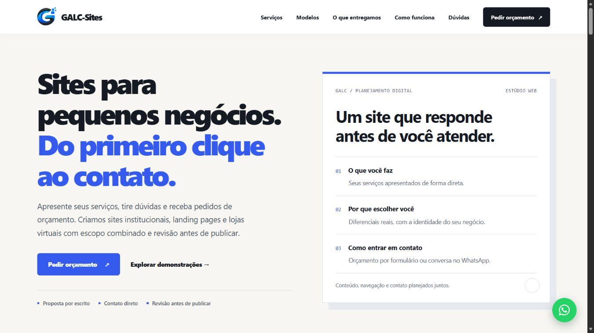

# GALC-Sites V2.5 — registro de validação antes do merge

## Base e recuperação
A main 978cb342b9cdd843dc53d3b25727b8a5324979a6 adicionava três PNGs, sem referências no site. A árvore anterior era fcf59081e330ac41acc11a149e5e56cbbd0e2455 (V2.4). Na branch feat/galc-v2-5-official-logo, fc0e4dfb363fed0f760c92fdc813d97071761890 restaurou essa árvore por novo commit; e97d8300ddb58881f55fea5f867da9ab428045d4 reaplicou os originais para preparação; ab5321ea178298b57d50cfa0e7c3e9b37be83ce3 integrou a marca no HTML/CSS. Produção não foi revertida temporariamente nem houve force push.

## Imagens e aplicação
O arquivo chamado horizontal é 1227×1226; símbolo original 1209×1209; versão menor 512×512. Originais preservados. O símbolo tem transparência real (alfa 0..255). Apenas margens transparentes foram aparadas; bbox 234,296–1028,1082. Não houve recriação por IA.

- Cabeçalho/legais: símbolo PNG de 96×96, exibido a 44 px no desktop e 40 px no mobile, com nome em texto.
- Rodapé: nome branco e base clara sob o símbolo.
- Favicon PNG32 (2.548 bytes) e PNG64 (6.680 bytes), também substituindo a imagem do SVG legado.
- Apple Touch Icon 180×180 (31.024 bytes).
- OG oficial 1200×630 (100.952 bytes).
- Cabeçalho: 12.409 bytes. Dimensões explícitas e proporção preservada.
- Nomes versionados com cache de um ano; futuros conteúdos devem usar novos nomes.

## Integridade
js/main.js, js/simulator.js, js/config.js e testes existentes não foram alterados. Preços e formulário mantidos. Seção do simulador comparada com a base e idêntica. Demonstrações tiveram apenas os links institucionais de favicon/Apple atualizados; suas marcas fictícias permanecem intactas.

## Testes
- 18 combinações reais no Edge/Chromium: home, privacidade e termos em 320×568, 375×812, 430×932, 768×1024, 1366×768 e 1920×1080. Sem overflow; imagens carregadas e marcas dentro da tela.
- Cabeçalho da home permanece 66 px mobile e 78 px desktop. Legais usam quebra responsiva em 320 px.
- Menu mobile, Escape/foco, seis destinos internos e cinco links WhatsApp corretos, com noopener.
- Simulador: Básico R$790; Básico+2 páginas R$1.090–1.390; Profissional+2 páginas R$1.790–2.090; Loja R$3.490 com páginas extras desabilitadas. Itens personalizados permanecem sob consulta. Transferência ao formulário e preservação de texto personalizado verificadas.
- Formulário vazio bloqueado, foco no nome e chave carregada. Nenhum envio real de formulário ou WhatsApp nesta missão.
- Console sem erros atribuíveis ao site nos momentos inspecionados.
- Logo do rodapé carregada após rolagem; nome branco no fundo #0b1629.
- OG inspecionado visualmente; favicon32 carregado no navegador e reconhecível.
- 11 testes node:test aprovados, zero falhas.
- Cinco imagens verificadas por assinatura PNG, dimensão e HEAD: HTTP 200, image/png, public/max-age=31536000/immutable.
- Job final: https://github.com/Guilherme-Augusto-INF/GALC-Sites/actions/runs/38994629810 — success. Duas tentativas anteriores da verificação falharam por escape no teste de assinatura e HTTP403 do cliente urllib; o teste foi corrigido para bytes explícitos e curl. Não eram falhas do site.
- Workflows temporários contents:read e checkout sem persistência de credenciais, removidos da árvore final. Script de preparação mantido fora do frontend, sem dependência de runtime.

## Lighthouse preview real
16/10/2026, 23:20 BRT. https://pagespeed.web.dev/analysis/https-0467eb07-galc-sites-pages-dev/b662iolsyh?form_factor=mobile

| Métrica | Mobile | Desktop |
|---|---:|---:|
| Performance | 100 | 100 |
| Acessibilidade | 100 | 100 |
| Boas práticas | 100 | 100 |
| SEO | 69 | 69 |
| LCP | 1,0 s | 0,3 s |
| FCP | 1,0 s | 0,3 s |
| TBT | 0 ms | 0 ms |
| CLS | 0 | 0 |
| Speed Index | 2,2 s | 0,4 s |

Preview mantém bloqueio de indexação. Medição de produção e commit implantado serão registrados no PR #6 após o merge. Lighthouse13.5.0 / HeadlessChromium153, Moto G Power emulado/4G lento e desktop emulado. Dados laboratoriais; não são INP/CrUX reais.

## Evidência visual

## Limitações
ZIP local não extraído porque o ambiente local ficou desconectado; utilizados os três PNGs originais já enviados à main pelo proprietário. Sem teste de recebimento postal, mensagens reais, leitor de tela integral ou pentest. Os testes antigos não são apresentados como novos envios reais.

A conclusão da publicação e smoke em produção deve ser consultada em https://github.com/Guilherme-Augusto-INF/GALC-Sites/pull/6 .
